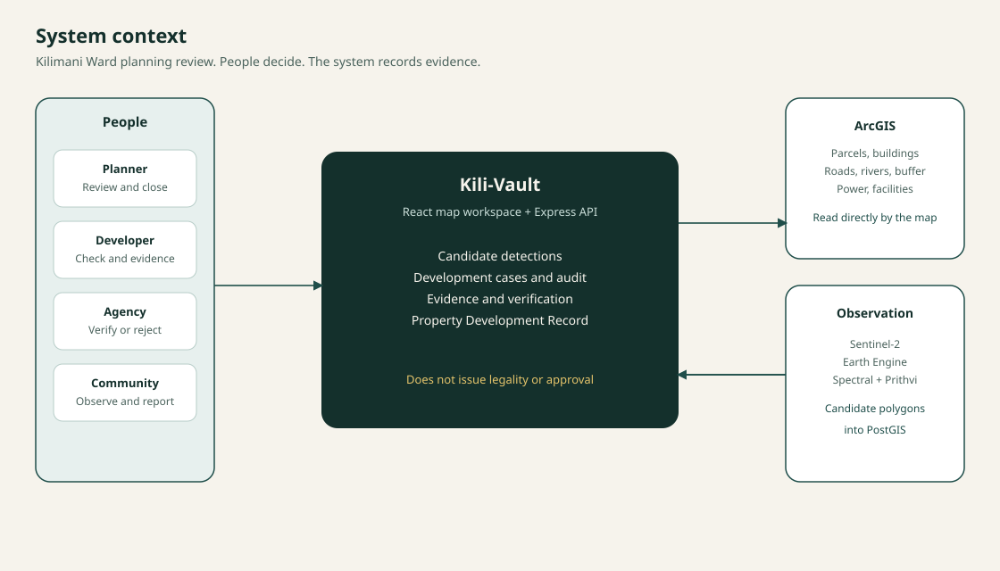
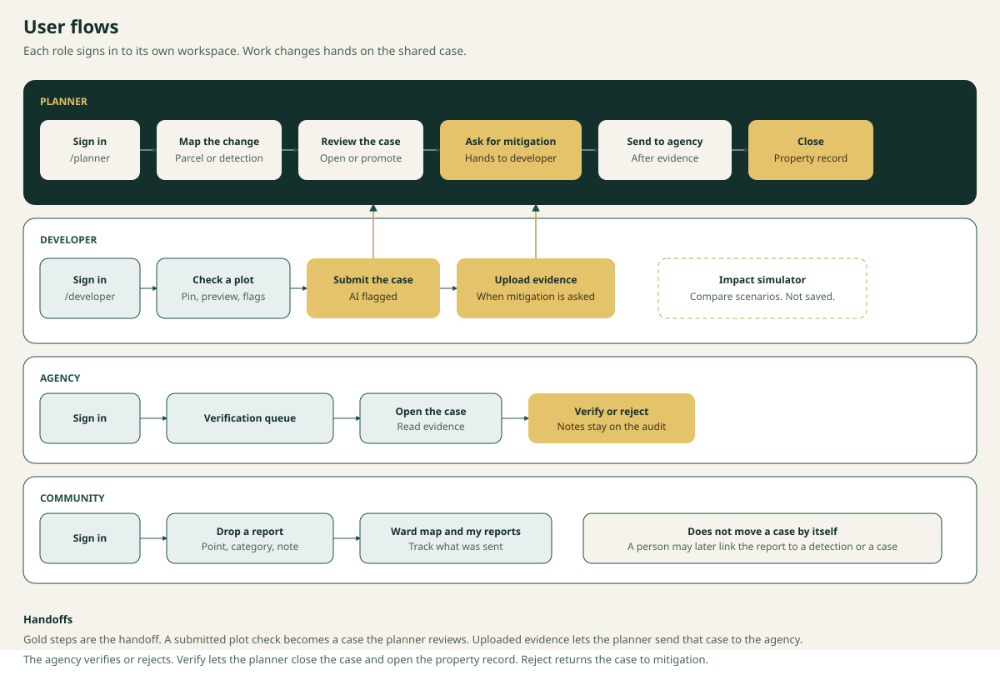
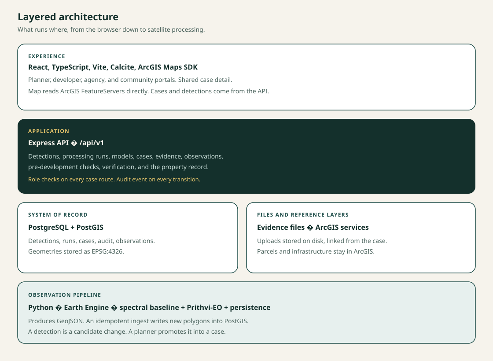
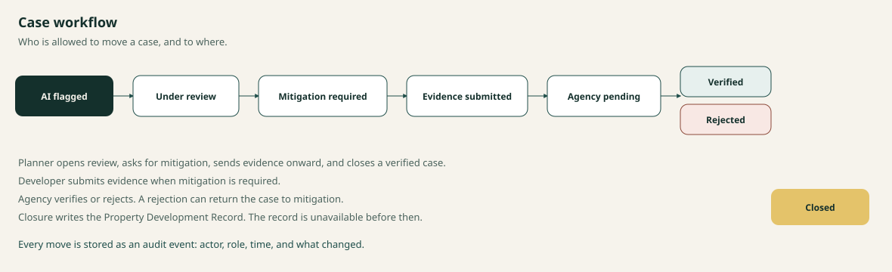

# System architecture

This is the architecture of Kili-Vault as built on the `development` branch. It covers the whole product: the four portals, the ArcGIS map, the case record, and the satellite detection pipeline.

The detection engine alone is also written up in `kili-vault-backend/docs/ARCHITECTURE.md`. Route shapes are in `kili-vault-backend/docs/API.md`. This document is the map of how those parts sit together.



## Purpose and boundary

**Area.** Kilimani Ward, Dagoretti North Sub-County, Nairobi County, Kenya.

**Job.** Help a planning team see candidate physical change, place it on a parcel, collect evidence, and keep a human decision trail.

**Boundary.** Kili-Vault does not determine legality, zoning compliance, or development approval. Scores, buffers, and wayleave screens are review signals. The wording in the product and in stored records stays descriptive.

## Context

Five things sit around the application:

| Neighbour | Relationship |
| --- | --- |
| Planner, developer, agency, community | Use a signed-in portal. Identity is a role plus a user id. |
| ArcGIS FeatureServers | Authoritative mapped context. The browser reads them directly. Kili-Vault does not edit them. |
| Copernicus Sentinel-2, via Google Earth Engine | Source imagery for candidate change. |
| PostgreSQL with PostGIS | System of record for detections, runs, cases, audit events, and community observations. |
| Evidence files on disk | Uploaded documents and photos, addressed from the case record. |

There is no separate workflow engine and no message bus. A case move is a request to the API, checked against the caller's role, then written with an audit event.

## Data flow

Three kinds of data move through the system, and they do not all land in the same place.


**Satellite write.** Sentinel-2 imagery is processed as a batch. Earth Engine builds the composites, the ensemble scores each candidate, and a GeoJSON ingest writes new polygons into `detections`. A page load never calls Earth Engine. The map only sees detections that have already been stored. A spatial hash drops a candidate that a previous run already inserted.

**Human write.** People change the record only through the API, and only in the role they hold.

- A planner promotes a detection into `development_cases`.
- A developer submit on the plot check also opens a case, with the proposal stored on that case.
- A developer upload writes the file to disk and a row to `case_evidence_items`.
- A planner or agency status change updates the case and appends `case_audit_events`.
- A community report inserts `community_observations`. It does not create a detection and it does not move a case.

**Read.** The browser loads ArcGIS layers directly from the FeatureServers. Those layers are not copied into PostGIS, and the app does not write back to ArcGIS. The API reads PostGIS and the evidence files, then serves GeoJSON to the maps, counts to the dashboards, and the case bundle to the case page. The property record is not stored as its own table. The API assembles it from a closed case, its audit, its evidence, and any linked detection. The impact simulator measures geometries the map has already drawn and keeps the result on screen.

A detection can exist with no case. A plot-check case can exist with no satellite detection. A community report stays in its own table until a person links it.

## User flows



**Planner.** Sign in to the command center, open the Kilimani map, and select a parcel or a detection. Promote detections that need a human record, or open a case that a developer already submitted. From the case, ask for mitigation, and after evidence is in, send it to the agency. When the agency has verified it, close the case. Closing is what makes the property record available.

**Developer.** Sign in to Development Cases, or go straight to Check a plot. The plot check previews risk, flags, and a disclaimer, then submit opens an AI-flagged case. Later, if the planner has asked for mitigation, upload evidence on that case. The impact simulator is a separate path: pick a parcel, compare existing, proposed, and mitigated, and leave. Nothing from the simulator is written.

**Agency.** Sign in to the verification queue, open a case, read the evidence, and verify or reject. The note stays on the audit trail. Verify returns the case to the planner for closure. Reject returns it to mitigation so the developer can respond again.

**Community.** Sign in, drop a point with a category and a description, then find that report on the home list and the ward map. The report is visible to planners as a ground observation. It does not change a case status on its own.

## Layers



### Experience

`kili-vault-frontend` is a React and TypeScript single-page app, built with Vite. Maps use the ArcGIS Maps SDK. Shared chrome uses Calcite components, including dark mode through the `calcite-mode-dark` class.

Routing is role-scoped:

- `/login` then a redirect into the caller's home.
- `/planner`, `/developer`, `/agency`, `/community`, each with its own shell.
- A shared case page under each shell: `cases/:id`.

The frontend holds two clients:

- **ArcGIS.** Layer registry in `src/config/mapLayers.ts`. Parcels, buildings, roads, rivers, buffers, power, facilities, and boundaries. Spatial reference comes from the service (Web Mercator). The app does not reproject those layers by hand.
- **Kili-Vault API.** Detections, cases, observations, pre-development checks, and the property record, through `src/lib/api.ts`.

The impact simulator calculates in the browser from geometries the map has already queried. It introduces no backend contract.

### Application

`kili-vault-backend/src` is an Express API mounted at `/api/v1`.

| Area | Routes | Responsibility |
| --- | --- | --- |
| Health | `/health`, `/health/live`, `/health/ready` | Process up, and database readiness including PostGIS. |
| Detections | `/api/v1/detections`, `/geojson`, `/stats`, `/:id` | Paginated candidates, map feed, aggregates, one record with evidence. |
| Processing | `/api/v1/processing/runs` | Run history: date windows, counts, model version, status. |
| Models | `/api/v1/models/status`, `/train`, `/verify`, `/pipeline/auto` | Whether the ensemble is loaded, and operator actions on the pipeline. |
| Cases | `/api/v1/cases` | List, stats, GeoJSON, status, mitigation, evidence, verification, property record, detection promotion, pre-development preview and submit, observations. |

Case routes require the development auth middleware. Callers send a bearer token or, in development, `X-User-ID` and `X-User-Role`. The service then checks the role before a transition. A developer reading a case must be the assigned developer.

Evidence upload uses multipart form data. Files land in a per-case directory. The database stores the path, type, uploader, status, and metadata. The largest accepted file is 10 MB.

If PostgreSQL is not configured, the case store can fall back to an in-memory implementation so the interface still runs. PostGIS is the intended system of record.

### System of record

Schemas live in `kili-vault-backend/database/`.

| Table | Holds |
| --- | --- |
| `detection_runs` | One Earth Observation run: windows, imagery count, detection count, model version, status, breakdown. |
| `detections` | One candidate polygon in EPSG:4326, change type, confidence, baseline and Prithvi probabilities, NDVI and NDBI deltas, persistence, area, centroid, evidence JSON, and a deduplication hash. |
| `development_cases` | The review record: case number, optional detection, status, risk JSON, geometry, parcel reference, assigned developer, mitigation list. |
| `case_audit_events` | Append-only history for that case. |
| `case_evidence_items` | File metadata for uploads. |
| `community_observations` | A human point report, separate from detections, with optional links to a detection and a case. |

Spatial columns use GiST indexes. Detections are deduplicated on a spatial hash so overlapping runs do not insert the same candidate twice.

### Observation pipeline

Python under `kili-vault-backend` prepares imagery and classifies change. The Node API does not reimplement that math. It ingests the GeoJSON the pipeline emits.

```text
Sentinel-2
  -> cloud and shadow masking, temporal median composite
  -> spectral difference (NDVI, NDBI, NDWI)
  -> candidate mask, cleanup, vector polygons
  -> ensemble classifier
  -> GeoJSON + run summary
  -> idempotent ingest into PostGIS
```

**Model A, spectral baseline.** A drop in NDVI of about 0.10 or more suggests canopy clearance. A rise in NDBI of about 0.10 or more suggests newly exposed built material. A recent NDBI at or above about 0.05 is required before the change is treated as built, so dry bare soil is not called a building on the index alone.

**Model B, Prithvi-EO.** A multispectral transformer adapter over six bands (blue, green, red, narrow near-infrared, and two shortwave infrared bands). The head classifies no change, building development, infrastructure change, land clearing, vegetation change, and surface change. If the pretrained weights are missing, the adapter reports that it is not loaded. It does not invent a probability.

**Ensemble.** With all three inputs present, the score is about half spectral baseline, 30 percent Prithvi, and 20 percent temporal persistence. Without Prithvi, those weights renormalise to about 71 percent baseline and 29 percent persistence. Further rules:

- A long, thin feature (aspect ratio about 3.2 or more) is infrastructure, such as a road or trench, rather than a building.
- Canopy loss without a positive built signature is land clearing.
- A weak persistence, under about 0.35, is surface change rather than a lasting development.

Change types stored on a detection are `BUILDING_DEVELOPMENT`, `INFRASTRUCTURE_CHANGE`, `LAND_CLEARING`, `VEGETATION_CHANGE`, `SURFACE_CHANGE`, and `UNKNOWN`.

A planner promotes detections into cases through `POST /api/v1/cases/promote-detections`. Promotion is a human step. The pipeline does not open cases by itself.

## Case architecture



The case is the unit of work that the portals share. A detection may exist with no case. A case may exist from a pre-development submission with no satellite detection. Once linked, the case keeps the detection id and can show the spectral evidence beside the human record.

Status changes are a small allow-list in both the frontend permissions module and the backend case service. The frontend hides illegal moves. The backend rejects them.

Risk on the case is computed for queue priority. Inputs are confidence (up to 30 points), area (up to 25), persistence (up to 20), and infrastructure proximity (up to 25). The band is low, medium, high, or critical. The field is stored as JSON on the case. It is not a compliance result.

The property record is not a second database. `propertyRecordService` reads a closed case, its audit events, its evidence rows, and the linked detection, then returns one document. Asking for it before closure returns a conflict. The record states its provenance and its limitations in the payload.

## Map architecture

Two geometries meet on the screen, and they stay in their own systems.

| Question | Answered by |
| --- | --- |
| Where is the parcel, what is its land use, what buildings are mapped, how near is a river or a power line? | ArcGIS FeatureServer, queried by the map. |
| What candidate change did the model see, and how confident is it? | `GET /api/v1/detections/geojson`, drawn by the map. |
| What case exists here, and what is its status? | `GET /api/v1/cases/geojson` and the case API. |
| What did a resident report? | Community observations API. |

Detection selection opens the detection detail, updates selection state, shows confidence and change type, and navigates to that geometry. Feature highlighting is used for FeatureServer layers such as parcels, roads, and facilities. The detection layer does not run an expensive GeoJSON-wide highlight.

The layer inventory and the field names the planner panel expects are listed in `featurelayers.md`. Zoning reference used by the planning tools is in `kilimani_zoning_guidelines-v2.md`.

## Request paths

The same journeys, as the calls that carry them. The data-flow and user-flow diagrams above are the picture. This is the sequence of writes.

**Review a satellite change**

```text
Pipeline writes detection
  -> planner map loads GeoJSON
  -> planner promotes detections to cases
  -> planner sets UNDER_REVIEW, then MITIGATION_REQUIRED
  -> developer uploads evidence
  -> planner sets AGENCY_PENDING
  -> agency verifies
  -> planner closes
  -> GET /cases/:id/property-record
```

**Check a plot before a proposal**

```text
Developer places a pin on the ArcGIS map
  -> POST /cases/pre-development/preview
  -> API returns risk, flags, confidence, disclaimer
  -> POST /cases/pre-development/submit
  -> a case is created at AI_FLAGGED with the proposal stored in evidence
```

The preview polygon is a small square around the pin. It marks the place of the question. It is not a surveyed site boundary.

**Compare a scenario**

```text
Developer selects a parcel on the ArcGIS map
  -> browser measures existing building intersection, area, road and river distance, river-buffer intersection
  -> proposed and mitigated rectangles are drawn locally
  -> nothing is written to the API or to ArcGIS
```

**Community report**

```text
Resident drops a point and writes a description
  -> POST /cases/observations
  -> row in community_observations
  -> a reviewer may later link it to a detection or a case
```

## Trust rules built into the design

- A detection record includes the explanation and the factor breakdown in `evidence`, so a reviewer can see why it was flagged.
- Model version is stored on the detection and on the run.
- Duplicate candidates collapse on the deduplication hash.
- Role is checked on the server for case reads and writes.
- Evidence stays in a pending status until a person verifies it.
- The property record refuses to exist before closure, so a draft cannot be mistaken for a finished planning record.
- Unavailable datasets are reported as unavailable. A missing flood layer is not treated as a clear site.
- Wayleave distances and the pre-development coverage, floor, and setback figures are labelled as screens and guidance.

## Repository map

```text
kili-vault-frontend/     React portals, map, case UI
kili-vault-backend/src   Express API, case and detection services
kili-vault-backend/database
kili-vault-backend/gee   Earth Engine imagery and change detection
kili-vault-backend/models
                         baseline, prithvi, ensemble
kili-vault-backend/processing
kili-vault-backend/docs  Engine architecture, API, setup
docs/                    This product guide and this architecture
featurelayers.md         ArcGIS layer catalogue
```

## Runtime shape

Local development is three processes, plus ArcGIS on the public internet:

```text
Browser
  -> Vite dev server (frontend)
  -> Express (API) -> PostgreSQL/PostGIS
                   -> evidence directory
  -> ArcGIS Online FeatureServers
Python pipeline (batch, not inside the request)
  -> Earth Engine
  -> GeoJSON
  -> ingest script into the same database
```

The web request path does not call Earth Engine. Processing runs are batch work. The API serves whatever has already been ingested, and exposes model and run status so an operator can see whether that batch is healthy.

Authentication in the current build is development auth: a known demo user and role headers. It is enough to enforce the role rules. It is not a production identity provider.
