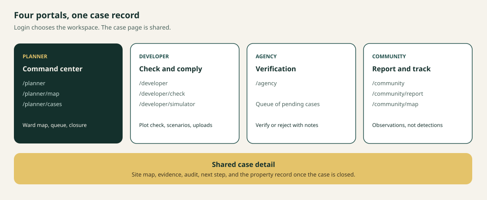
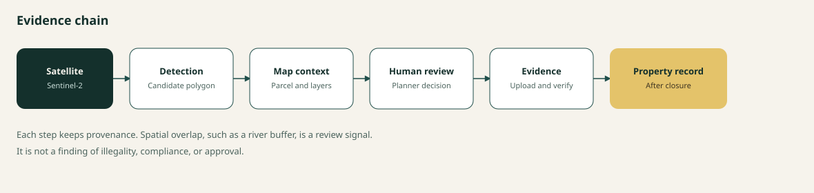

# What we built

Kili-Vault is a map-first planning and development review workspace for **Kilimani Ward**, Dagoretti North, Nairobi. It joins satellite observations, parcel context, development cases, field evidence, and human verification into one record.

This document describes the system on the `development` branch: what a person can do in it today, how the pieces fit, and what is still deliberately unfinished.

The machine never decides that a change is illegal, compliant, or approved. It surfaces a **candidate change** and the spatial context around it. A person reviews that evidence and moves the case.



## Who it is for

Login opens one of four workspaces. Each role sees only the actions it is allowed to take.

| Role | Workspace | What they do |
| --- | --- | --- |
| Planner | `/planner`, `/planner/map`, `/planner/cases` | See the ward, inspect parcels and detections, move cases, require mitigation, and close a verified case. |
| Developer | `/developer`, `/developer/check`, `/developer/simulator` | See assigned cases, check a plot before building, compare a scenario, and upload evidence. |
| Agency | `/agency` | Work the verification queue and verify or reject a case. |
| Community | `/community`, `/community/report`, `/community/map` | Submit a ground observation and look at the public ward map. |

The case screen is shared. Planner, developer, agency, and community each open it from their own list, with a back link into their own workspace. What they can change still depends on role.

## The story the product tells



1. Sentinel-2 imagery is compared across two time windows.
2. The detection engine writes a candidate polygon: change type, confidence, area, and a short spectral explanation.
3. The planner map places that polygon on parcels, buildings, roads, rivers, and other Kilimani layers.
4. A planner promotes detections into development cases and reviews them.
5. A developer responds with evidence when mitigation is required.
6. An agency verifies or rejects.
7. When the case is closed, the API assembles a **Property Development Record** from the case, its audit trail, its evidence, and any linked detection.

Community observations sit beside this chain. They are human reports with a point and a description. They are not satellite detections, and they are stored separately.

## What each workspace actually contains

### Planner

The planner shell is the command point.

- **Dashboard** shows ward status, detection statistics, a priority case, the review queue, and the workflow summary.
- **Kilimani Map** is the full planning map. Selecting a parcel shows land use, area, mapped buildings, footprint, road and river proximity, the river-buffer relationship, and related cases. Selecting a detection shows its id, change type, confidence, and the route into a case.
- **Development Cases** is the registry: search, status, workflow stage, and the case row. Opening a case keeps the same queries, permissions, and status changes as before the redesign.
- **Guided demo** walks a presenter from the command center through parcel context, a detection, a scenario, evidence, agency verification, and the closed property record.

Planner tools on the map include distance and area measurement, temporary sketches, parcel buffers, and constraint checks. The Kiliplan workspace shows **Buildings + Parcels** so a footprint and its joined parcel and land-use attributes are visible together. Other maps keep their own layer choice.

### Developer

- **Development Cases** lists the developer's cases, with status counts and an action-required section.
- **Check a plot** (`/developer/check`) is a map-centric pre-development check. The map stays visible. The current step sits in a docked panel on a wide screen and below the map on a small one. The developer drops a pin, describes the proposal, and receives an indicative assessment: risk, flags, confidence, and a disclaimer. Moving the pin after a result clears the assessment. Preview and submit, the assessment fields, and JSON export are all kept.
- **Impact simulator** (`/developer/simulator`) compares an existing parcel condition with a proposed scenario and a mitigated scenario. Footprints are temporary rectangles for planning conversation. They are not building designs, they are not written to ArcGIS, and they are not saved on the server.

The plot check uses indicative ward guidance only: about 60% coverage, 4 floors, and a 3 metre setback. Crossing those figures raises a review flag. It does not apply a legal limit.

### Agency

The agency workspace is a verification queue. From a case, the agency can verify or reject, including from evidence that has been submitted. The decision and the notes stay on the audit timeline.

### Community

- **Home** shows the person's own reports.
- **Report** submits a point, a category, and a description. Categories include construction, land clearing, dumping, drainage, noise, and other.
- **Ward map** uses the full workspace for the ArcGIS map, with a compact toolbar, report navigation, and active case locations. The map renders while case data is still loading.

An observation can later be linked to a detection or a case. Until a person does that, it remains a ground report.

## The case, from flag to record


| Status | Meaning |
| --- | --- |
| AI flagged | A detection was promoted, or a pre-development check was submitted. Nobody has reviewed it yet. |
| Under review | A planner has opened it. |
| Mitigation required | The planner has asked the developer to respond. |
| Evidence submitted | The developer has uploaded a response. |
| Agency pending | The planner has sent it for formal verification. |
| Verified or rejected | The agency has decided. A rejection can return the case to mitigation. |
| Closed | The planner has closed a verified case. The property record becomes available. |

Allowed moves:

- Planner: flagged to under review or closed; under review to mitigation or closed; evidence submitted to agency pending; verified to closed; rejected back to mitigation.
- Developer: mitigation required to evidence submitted.
- Agency: agency pending, or evidence submitted, to verified or rejected.

Risk shown on a case is a **review priority**, not a violation score. The scorer weighs detection confidence, footprint size, how persistent the change looks, and proximity to rivers, drainage, and roads. High means "look at this sooner."

Evidence uploads are files up to 10 MB, stored on disk and linked to the case. They stay pending until a person verifies them. The audit trail records the actor, role, time, and what changed.

The Property Development Record is assembled only after closure. It includes the parcel reference, ward, location, the lifecycle taken from audit events, any pre-development proposal stored on the case, linked observed change, evidence references, verification notes, provenance, and stated limitations. A developer can read only a case assigned to them.

## What the map is reading

The browser talks to ArcGIS FeatureServers for place, and to the Kili-Vault API for cases and detections. The two are not copies of each other.

Mapped context includes the Kilimani ward boundary, Dagoretti constituency, parcels joined to land use, land-use polygons, building footprints, buildings joined to parcels, roads, rivers, a 15 metre river buffer, 11 kV and 66 kV power lines, and points for culture, education, health, and local orientation.

Parcel checks use a 10 metre preliminary screen for 11 kV lines and a 60 metre screen for 66 kV lines. Those are planning screens. They are not a Kenya Power, KENGEN, or KETRACO clearance. Flood zones, protected wetlands, and historic-preservation layers are not in this workspace. The tools say those checks are unavailable.

Selecting a road, power line, facility, or point highlights the real feature, looks up intersecting parcel context, and shows planning fields first. Missing values are shown as not available in the current dataset.

A factual evidence brief can be downloaded from the map as a text file generated in the browser. It describes spatial context and limitations. It does not label a change illegal or approved.

## How to run it

Frontend:

```powershell
Set-Location kili-vault-frontend
npm install
npm run dev
```

Backend:

```powershell
Set-Location kili-vault-backend
npm install
npm run dev
```

Database, Earth Engine credentials, and model weights are covered in `kili-vault-backend/docs/SETUP.md`. The API also documents each route in `kili-vault-backend/docs/API.md`.

## What is built, and what is intentionally later

Built and usable on this branch:

- Four role portals, with Calcite layout, dark mode, and responsive map workspaces.
- Planner map with parcel intelligence, detection selection, measurement, sketch, buffers, and constraint checks.
- Development case registry, shared case detail, evidence upload, mitigation, agency verification, and audit history.
- Pre-development plot check and a client-side impact simulator.
- Community reports and a community ward map.
- Detection API, GeoJSON feed, processing-run history, and model status.
- Property Development Record after case closure.

Still later, on purpose:

- 3D massing.
- Reading GPS out of photo EXIF.
- Checking that an uploaded photo falls near the case geometry.
- Saving the map evidence brief on the server, and attaching it automatically to the property record.
- Persisting simulator scenarios.
- Treating the Prithvi model as required. If its weights are absent, the ensemble continues on the spectral baseline and temporal persistence, and says the foundation model was not loaded.

The detection-engine detail, including indices and ensemble weights, lives in [System architecture](SYSTEM_ARCHITECTURE.md) and in `kili-vault-backend/docs/ARCHITECTURE.md`.
